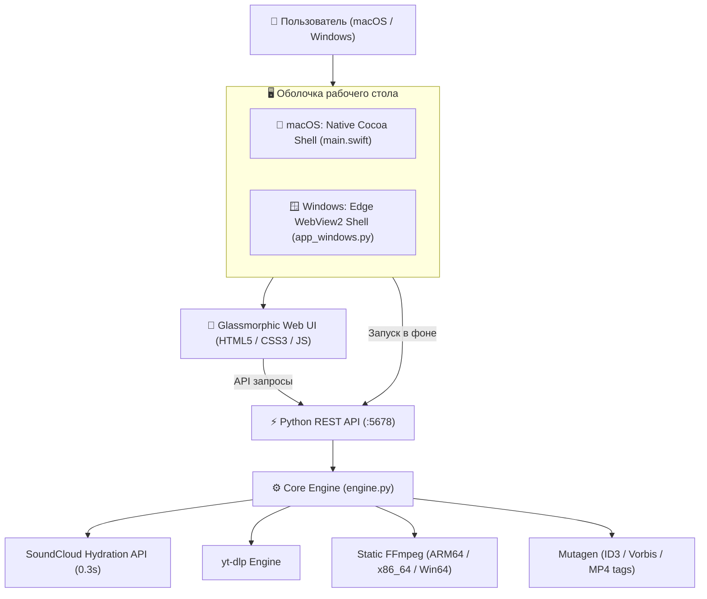

# 🎵 SoundCloud Downloader (SoundD) for macOS & Windows

<p align="center">
  
  &nbsp;&nbsp;&nbsp;&nbsp;&nbsp;&nbsp;
  
</p>

<p align="center">
  <b>Быстрое, нативное и стильное кроссплатформенное приложение для macOS и Windows для скачивания треков, плейлистов и альбомов с SoundCloud с выбором качества, пакетным экспортом в ZIP и умным выравниванием громкости.</b>
</p>

<p align="center">
  
  
  
  
  
  
  
</p>

---

## 📥 Скачать приложение

Готовые сборки доступны на странице **[Releases](https://github.com/Giba8524/SoundD/releases)**:

| Платформа | Файл для загрузки | Описание |
| :--- | :--- | :--- |
| 🪟 **Windows (Установщик)** | [**`SoundCloud-Downloader-Setup.exe`**](https://github.com/Giba8524/SoundD/releases/latest) | **Рекомендуется:** полноценный мастер установки Windows, создание ярлыка и автодеинсталлятор |
| 🪟 **Windows (Портативная)** | [**`SoundCloud-Downloader-Windows-Portable.zip`**](https://github.com/Giba8524/SoundD/releases/latest) | Автономная портативная версия (не требует установки, распакуй и запусти `.exe`) |
| 🍏 **macOS** | [**`SoundCloud-Downloader-macOS.zip`**](https://github.com/Giba8524/SoundD/releases/latest) | Нативный `.app` бандл для Apple Silicon (M1/M2/M3/M4) и Intel |

---

## ✨ Ключевые возможности

### 🎧 1. Скачивание отдельных треков
* **Моментальное распознавание:** автоматическое извлечение названия, автора, жанра, хронометража и обложки максимального разрешения (500x500).
* **Анализ исходного потока:** приложение определяет реальный формат на серверах SoundCloud (например, `AAC 160 kbps HQ` или `MP3 128 kbps`) и предупреждает, если автор предоставил оригинальный несжатый мастер-файл.
* **Вшивание метаданных:** оригинальные обложки высокой четкости и ID3/Vorbis теги (артист, название, альбом, жанр) автоматически вшиваются в аудиофайл.

### 📦 2. Плейлисты и альбомы
* **Пакетное скачивание в один ZIP-архив** по умолчанию.
* Альтернативный режим: сохранение отдельной аккуратной папкой.
* **Интерактивный чеклист:** можно скачать весь альбом целиком или отметить только понравившиеся треки.
* Автоматическая аккуратная нумерация (`01. Artist - Track.mp3`).

### ▶️ 3. Встроенный плеер предпрослушивания (Audio Preview)
* **Плавающий мини-плеер:** обложка, перемотка, текущее время и длительность, регулятор громкости.
* **Двойной клик:** мгновенный запуск любого трека прямо из списка плейлиста или клик по кнопке Play.
* **Фоновое воспроизведение:** плеер не прерывается во время процесса скачивания.

### ⚖️ 4. Честные качества и точный расчёт веса
* **Только реальные форматы:** отображаются только те качества, которые физически доступны на SoundCloud (без обманчивого апскейлинга до 320k или FLAC для сжатых 128/160k стримов).
* **Точный вес файла:** динамический расчёт мегабайт строго по реальному битрейту без раздувания.

### 🔊 5. Умный Smart Volume Boost (Нормализация громкости)
* Сканирование пиковой громкости трека через двухпроходный FFmpeg `volumedetect`.
* **Треки обычной и высокой громкости остаются на 100% нетронутыми** (никакого приглушения или ухудшения динамического диапазона).
* Слишком тихие треки (пик тише `-2.0 dB`) мягко и безопасно усиливаются до эталонных `-0.5 dB` без малейшего клиппинга.

### 📋 6. Умный буфер обмена (Smart Clipboard)
* При переключении в окно приложения оно автоматически проверяет буфер обмена.
* Если скопирована ссылка на SoundCloud, появляется элегантный тост с предложением загрузить трек в один клик.

### 🖥️ 7. Глубокая интеграция с операционной системой
* **macOS:** Нативное окно Cocoa + WebKit, размытие Apple Glassmorphism, типографика SF Pro, интеграция с Finder (`open -R`) и AppleScript.
* **Windows:** Нативное окно Edge WebView2 (Chromium), системные Toast-уведомления Windows, интеграция с Проводником (`explorer /select`) и системный выбор папок `FolderBrowserDialog`.

---

## 🎚️ Доступные форматы и качество

| Формат | Битрейт | Описание | Особенности |
| :--- | :--- | :--- | :--- |
| **⚡ Direct Stream** | Исходный (1:1) | Оригинальный поток напрямую с SoundCloud | Без перекодирования, моментальная скорость |
| **🎵 MP3 320 kbps** | 320 kbps | Максимальный битрейт MP3 | Идеально для автомагнитол, плееров и колонок |
| **🎵 MP3 256 kbps** | 256 kbps | Высокое качество | Оптимальный баланс размера и детализации |
| **🎵 MP3 128 kbps** | 128 kbps | Стандартный стрим | Минимальный размер файла |
| **🎧 M4A / AAC 256** | 256 kbps | Родной формат экосистемы Apple | Для Apple Music, iPhone, iPad и Mac |
| **💎 FLAC** | Lossless | Аудиоконтейнер без потерь | Сохраняет звук без дополнительного сжатия |
| **🔊 WAV** | 1411.2 kbps | Студийный несжатый 16-bit PCM | Чистый необработанный аудиопоток |

---

## 🚀 Установка и запуск

### 🍏 Инструкция для macOS:
1. Скачайте архив **`SoundCloud-Downloader-macOS.zip`** из [Releases](https://github.com/Giba8524/SoundD/releases).
2. Распакуйте архив и перетащите **`SoundCloud Downloader.app`** в папку **«Программы»** (`/Applications`).
3. Запустите приложение через Launchpad или Spotlight!

### 🪟 Инструкция для Windows:
* **Вариант 1 (Установщик, рекомендуется):**
  1. Скачайте инсталлятор **`SoundCloud-Downloader-Setup.exe`** из [Releases](https://github.com/Giba8524/SoundD/releases).
  2. Запустите его, выберите язык (русский/английский) и нажмите «Далее». Мастер автоматически установит приложение и создаст ярлык на рабочем столе и в меню «Пуск».
  3. Запустите приложение из ярлыка!
* **Вариант 2 (Портативная версия):**
  1. Скачайте архив **`SoundCloud-Downloader-Windows-Portable.zip`**.
  2. Распакуйте папку и запустите **`SoundCloud Downloader.exe`**. Никаких терминалов, Python или сторонних утилит не требуется.

---

## 🛠️ Сборка из исходников

### Сборка на macOS:
```bash
git clone https://github.com/Giba8524/SoundD.git
cd SoundD

# Установка зависимостей
pip3 install -r requirements.txt

# Сборка .app бандла
./build.sh

# Сборка с созданием релизного ZIP-архива
./build.sh --dist
```

### Сборка на Windows:
```cmd
git clone https://github.com/Giba8524/SoundD.git
cd SoundD

:: Установка зависимостей
pip install -r requirements.txt pywebview pyinstaller

:: Запуск из исходников
python app_windows.py

:: Сборка автономного .exe файла через PyInstaller
pyinstaller --noconfirm --windowed --name "SoundCloud Downloader" --add-data "static;static" --icon "icon.ico" app_windows.py
```

---

## 🏛️ Кроссплатформенная архитектура



---

## 📂 Структура проекта

```text
├── SoundCloud Downloader.app/   # Бандл приложения для macOS
├── app_windows.py               # Лаунчер для Windows (Edge WebView2)
├── SoundCloud Downloader.bat    # Быстрый скрипт запуска под Windows
├── icon.ico                     # Нативная иконка для Windows
├── main.swift                   # Нативный код Cocoa + WebKit для macOS
├── engine.py                    # Кроссплатформенное ядро загрузки и конвертации
├── server.py                    # Локальный REST API сервер
├── static/                      # Веб-интерфейс (Glassmorphism, dark theme)
├── .github/workflows/           # Автоматическая сборка релизов для Windows и macOS
├── requirements.txt             # Зависимости Python
├── build.sh                     # Скрипт сборки под macOS
└── LICENSE                      # Лицензия MIT
```

---

## 📄 Лицензия

Проект распространяется под открытой лицензией [MIT](LICENSE).
