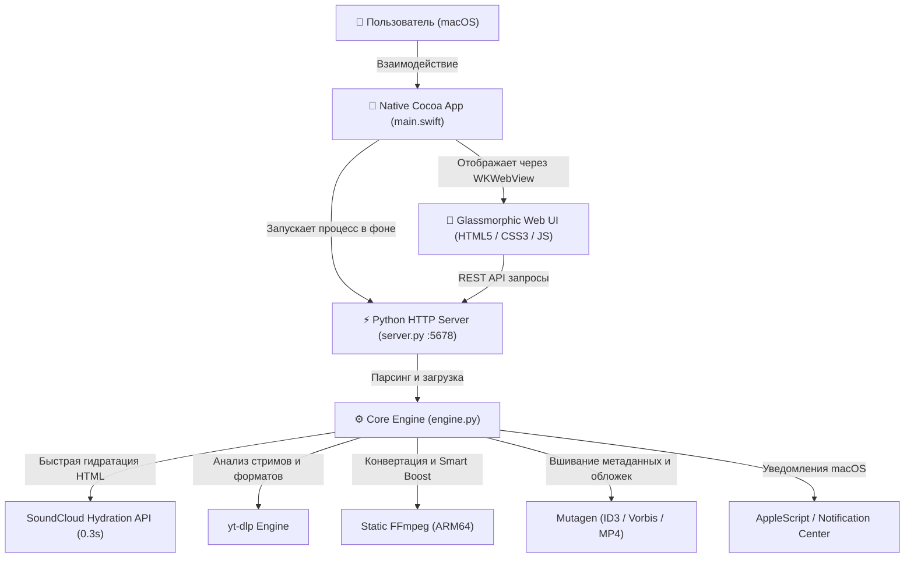

# 🎵 SoundCloud Downloader for macOS

<p align="center">
  
</p>

<p align="center">
  <b>Нативное, быстрое и стильное приложение для macOS для скачивания треков, плейлистов и альбомов с SoundCloud с поддержкой выбора качества, пакетного экспорта в ZIP и умного выравнивания громкости.</b>
</p>

<p align="center">
  
  
  
  
  
  
  
</p>

---

## ✨ Ключевые возможности

### 🎧 1. Скачивание отдельных треков
* **Моментальное распознавание:** автоматическое извлечение названия, автора, жанра, хронометража и обложки максимального разрешения (500x500).
* **Анализ исходного потока:** приложение определяет реальный формат на серверах SoundCloud (например, `AAC 160 kbps HQ` или `MP3 128 kbps`) и предупреждает, если автор предоставил оригинальный несжатый мастер-файл.
* **Вшивание метаданных:** оригинальные обложки высокой четкости и ID3/Vorbis теги (артист, название, альбом, жанр) автоматически вшиваются в аудиофайл.

### 📦 2. Плейлисты и альбомы
* **Пакетное скачивание в один ZIP-архив** по умолчанию.
* Альтернативный режим: сохранение отдельной аккуратной папкой.
* **Интерактивный чеклист:** можно скачать весь альбом целиком или отметить только понравившиеся треки.
* Автоматическая аккуратная нумерация (`01. Artist - Track.mp3`).

### ⚖️ 3. Динамический расчёт веса аудио
* На каждой карточке качества в реальном времени отображается примерный вес файла (`~4.1 МБ`, `~16.2 МБ`, `~137 МБ`).
* При выборе или снятии треков в плейлисте размер на всех карточках и на кнопке скачивания **пересчитывается на лету**.

### 🔊 4. Умный Smart Volume Boost (Нормализация громкости)
* Сканирование пиковой громкости трека через двухпроходный FFmpeg `volumedetect`.
* **Треки обычной и высокой громкости остаются на 100% нетронутыми** (никакого приглушения или ухудшения динамического диапазона).
* Слишком тихие треки (пик тише `-2.0 dB`) мягко и безопасно усиливаются до эталонных `-0.5 dB` без малейшего клиппинга.

### 📋 5. Умный буфер обмена (Smart Clipboard)
* При переключении в окно приложения оно автоматически проверяет буфер обмена macOS.
* Если скопирована ссылка на SoundCloud, появляется элегантный тост с предложением загрузить трек в один клик.

### 🖥️ 6. Нативный дизайн macOS
* Тёмная тема с глубоким эффектом размытия **Apple Glassmorphism** и типографикой SF Pro.
* Нативные всплывающие уведомления macOS со звуковым подтверждением по завершении скачивания.
* Кнопка **«Показать в Finder»** (`open -R`) для мгновенного перехода к скачанному файлу.
* Выбор целевой папки через системное диалоговое окно macOS.

---

## 🎚️ Доступные форматы и качество

| Формат | Битрейт | Описание | Особенности |
| :--- | :--- | :--- | :--- |
| **⚡ Direct Stream** | Исходный (1:1) | Оригинальный поток напрямую с SoundCloud | Без перекодирования, моментальная скорость |
| **🎵 MP3 320 kbps** | 320 kbps | Максимальный битрейт MP3 | Идеально для автомагнитол, плееров и колонок |
| **🎵 MP3 256 kbps** | 256 kbps | Высокое качество | Оптимальный баланс размера и детализации |
| **🎵 MP3 128 kbps** | 128 kbps | Стандартный стрим | Минимальный размер файла |
| **🎧 M4A / AAC 256** | 256 kbps | Родной формат экосистемы Apple | Для Apple Music, iPhone, iPad и Mac |
| **💎 FLAC** | Lossless | Аудиоконтейнер без потерь | Сохраняет звук без дополнительного сжатия |
| **🔊 WAV** | 1411.2 kbps | Студийный несжатый 16-bit PCM | Чистый необработанный аудиопоток |

---

## 🚀 Установка и запуск

### Вариант 1: Готовое приложение (Рекомендуется)
1. Скачайте архив **`SoundCloud-Downloader-macOS.zip`** из вкладки [Releases](../../releases).
2. Распакуйте архив и перетащите **`SoundCloud Downloader.app`** в папку **«Программы»** (`/Applications`).
3. Запустите приложение через Launchpad или Spotlight!

### Вариант 2: Запуск из папки проекта
Дважды кликните по файлу:
```text
SoundCloud Downloader.app
```
или запустите скрипт установки в систему:
```bash
./install_to_applications.sh
```

---

## 🛠️ Сборка из исходников

Для сборки требуется macOS 12+ с установленным `python3` и Xcode Command Line Tools (`xcode-select --install`).

```bash
# Клонируйте репозиторий
git clone https://github.com/<your-username>/soundcloud-downloader-macos.git
cd soundcloud-downloader-macos

# Установите зависимости Python
pip3 install -r requirements.txt

# Запустите скрипт автоматической сборки
./build.sh

# Чтобы также создать архив для релиза:
./build.sh --dist
```

---

## 🏛️ Архитектура проекта

Приложение построено на гибридной легковесной архитектуре, сочетающей нативный Swift/Cocoa и мощный Python-бэкенд:



---

## 📂 Структура файлов

```text
├── SoundCloud Downloader.app/   # Готовый бандл нативного macOS-приложения
├── main.swift                   # Нативный код Cocoa + WebKit + меню macOS
├── engine.py                    # Ядро загрузки, smart boost, конвертация и теги
├── server.py                    # Локальный REST API сервер
├── static/                      # Интерфейс (Glassmorphism, dark theme)
│   ├── index.html               # Разметка интерфейса
│   ├── style.css                # Стили macOS Big Sur / Sonoma Glassmorphism
│   └── app.js                   # Клиентская логика, расчёт веса треков
├── requirements.txt             # Зависимости Python
├── build.sh                     # Скрипт компиляции и сборки релиза
├── install_to_applications.sh   # Скрипт установки в /Applications
├── start.sh                     # Скрипт запуска для отладки
└── LICENSE                      # Лицензия MIT
```

---

## 📄 Лицензия

Проект распространяется под открытой лицензией [MIT](LICENSE).
Вы можете свободно использовать, модифицировать и распространять данный проект.
